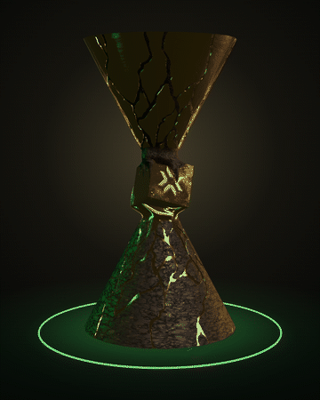

# LOUD · Campeões do Mundo 2026

Landing page imersiva, feita por fã, sobre a virada da **LOUD** no **VCT Champions Shanghai 2026**: do time que perdia tudo no começo do ano ao título mundial.

<p align="center">
  
</p>

## O que tem na página

1. **Abertura:** "Desacreditados → Campeões do mundo."
2. **A virada:** a história da temporada, que vai acendendo palavra por palavra conforme você rola.
3. **O elenco:** erde, lukxo, tkzin, Darker e DaviH, em rolagem horizontal.
4. **A taça:** o troféu em 3D gira com o scroll. Primeiro aparecem os campeões de 2026 e, "rebobinando" o tempo, o legado de 2022.
5. **A galeria:** um corredor 3D de pôsteres que termina na revelação do MVP, erde, chileno que lutou pelo Brasil.
6. **Epílogo:** LOUD, bicampeã do mundo.

## Tecnologias

- HTML, CSS e JavaScript puros, sem build e sem `npm install`
- [Three.js](https://threejs.org/) para o troféu 3D
- [GSAP + ScrollTrigger](https://gsap.com/) para as animações ligadas ao scroll
- [Lenis](https://lenis.darkroom.engineering/) para a rolagem suave

As bibliotecas são carregadas por CDN (jsDelivr).

## Como rodar localmente

O modelo 3D precisa ser servido por HTTP. Se abrir o `index.html` com duplo clique, a página aparece sem animações e sem o troféu 3D.

- **VS Code:** instale a extensão *Live Server*, clique com o botão direito no `index.html` e escolha **Open with Live Server**.
- **Python:** na pasta do projeto, rode `python -m http.server` e acesse <http://localhost:8000>.

## Como publicar (GitHub + Vercel)

1. **Crie o repositório.** No VS Code, abra a aba *Source Control* e clique em **Publish to GitHub**. Ou, pelo terminal:

   ```bash
   git init
   git add .
   git commit -m "Landing page LOUD Champions 2026"
   git branch -M main
   git remote add origin https://github.com/SEU-USUARIO/SEU-REPOSITORIO.git
   git push -u origin main
   ```

2. **Importe na Vercel.** Em <https://vercel.com/new>, escolha o repositório.
3. **Configure.** Em *Framework Preset*, deixe **Other**. *Build Command* e *Output Directory* ficam vazios, porque o site é estático.
4. **Clique em Deploy.** A cada `git push` na branch `main`, a Vercel publica a nova versão sozinha.

## Estrutura

```
├── index.html
├── css/style.css
├── js/
│   ├── main.js                  # scroll, preloader e animações das seções
│   └── trophy.js                # cena 3D do troféu (Three.js)
├── img/
│   ├── *.webp                   # fotos e pôsteres originais
│   ├── crop/                    # recortes usados na página
│   ├── raios.webp               # textura dos raios atrás do MVP
│   ├── trofeu_3d_otimizado.glb  # modelo 3D usado no site (texturas em JPEG)
│   └── trofeu_3d.glb            # modelo original, usado como reserva
└── docs/trofeu-3d.gif           # GIF deste README
```

## Créditos

- **Modelo 3D do troféu:** ["Trophée VCT Champions Valorant"](https://sketchfab.com/3d-models/trophee-vct-champions-valorant-4cfc0dfcdbe84d458a9bad510aed50eb), de [redmattc](https://sketchfab.com/redmattc), sob licença [CC BY 4.0](https://creativecommons.org/licenses/by/4.0/). Alterações: texturas recomprimidas para a web e base escurecida no código.
- **Fotos e pôsteres:** material de divulgação (LOUD e Riot Games / VCT). Os direitos pertencem aos respectivos autores.
- **Fontes:** [Anton](https://fonts.google.com/specimen/Anton), [Barlow](https://fonts.google.com/specimen/Barlow), [Barlow Condensed](https://fonts.google.com/specimen/Barlow+Condensed) e [Grenze Gotisch](https://fonts.google.com/specimen/Grenze+Gotisch), via Google Fonts (SIL Open Font License).
- **Bibliotecas:** [Three.js](https://github.com/mrdoob/three.js) (MIT), [GSAP](https://gsap.com/) (licença gratuita da GSAP) e [Lenis](https://github.com/darkroomengineering/lenis) (MIT).

## Aviso

Projeto de fã, sem vínculo oficial com a LOUD ou a Riot Games. VALORANT, VCT e Champions são marcas da Riot Games, e LOUD é marca da LOUD.
